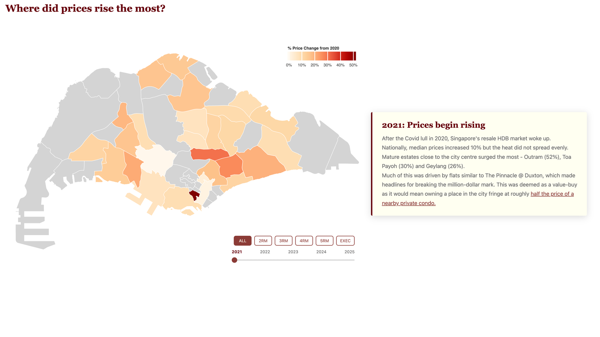
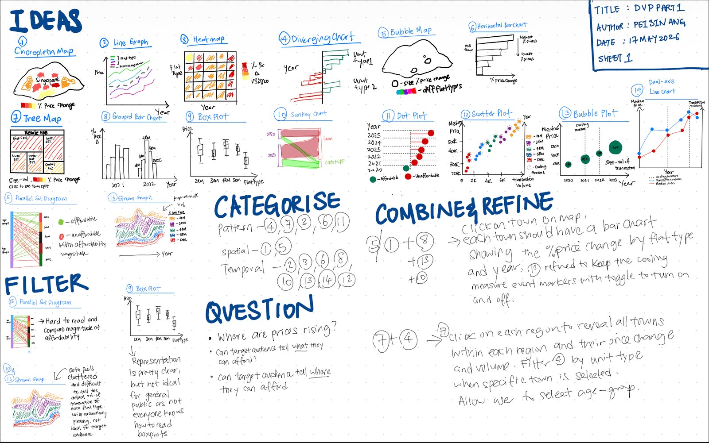
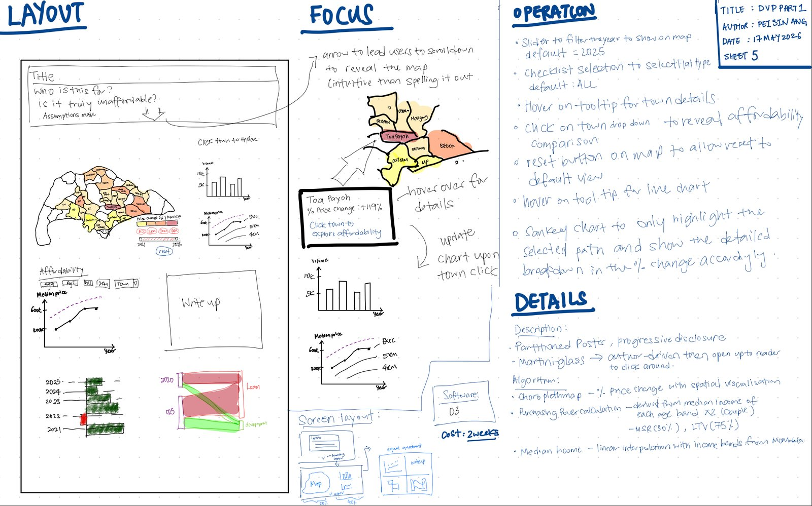

{fig-alt="Choropleth map of Singapore showing resale HDB price change by town"}

[Read the interactive story →](/fit5147_dvp_part2/){.btn-pill}

## Why I made this

As a real estate advisor in Singapore, I saw firsthand how quickly resale HDB prices were climbing, and how much harder it was getting for young Singaporeans hoping to own a home. HDB flats are subsidised public housing. Even though resale flats are bought and sold on the open market, the whole system exists to keep housing affordable. So when prices kept rising, I wanted to know whether it was still doing that job. This project brings together my experience in the field and my newfound analytics skills: I used HDB transaction and income data from 2020 to 2025 to test what I'd seen on the ground, and turned it into a story anyone could follow.

## What I found

From 2020 to 2025, median resale prices rose about **50%** nationally, and much more in some towns (Toa Payoh: **+119%**). The bigger surprise was that the loan buyers needed grew only about 25%, while the **cash and CPF needed upfront grew 275%**, because cooling measures tightened loan limits. Many young buyers aren't priced out by monthly repayments. They're priced out by the money they need up front.

## How I designed it

I sketched 19 ideas and three full alternative designs (a map, a treemap and a bubble chart) before writing any code. Each one taught me something about what my audience could and couldn't read.

::: {layout-ncol=2}
{fig-alt="Hand-drawn design sheet with 19 visualisation ideas"}

{fig-alt="Hand-drawn final design sheet"}
:::

A few decisions shaped the final piece:

- **Guided, then free to explore.** The map updates year by year as you scroll, then hands control to you. That way readers get the context before they're asked to read the data on their own.
- **Two charts answer two questions.** A diverging bar chart answers *"Can I afford it?"* A Sankey chart answers *"Why does it feel harder than the numbers suggest?"* Instead of the usual price-to-income ratio, I measured affordability the way a real purchase works: how much a buyer can borrow, and how much they must pay upfront in cash and CPF.
- **Real data vs my estimates.** Actual resale prices are drawn as a solid line. Purchasing power, which I calculated from income and loan rules, is drawn as a dotted line, so readers can tell what's measured and what's estimated.

**Built with:** R for data cleaning, then D3.js, d3-sankey and Scrollama. The data comes from HDB, the Ministry of Manpower and URA.

## What I'd improve

- **Show the range, not just the median.** My affordability chart compares one median price with one estimated purchasing power, but real buyers can vary. My data exploration and statistics modules in semester 2 taught me that a single number can hide this spread. A shaded band showing the typical range of incomes and prices would show who can comfortably afford a flat and who is borderline.
- **Look ahead.** Adding price and income projections would let me ask *"When might it become out of reach?"*

[Explore the full interactive story →](/fit5147_dvp_part2/){.btn-pill}